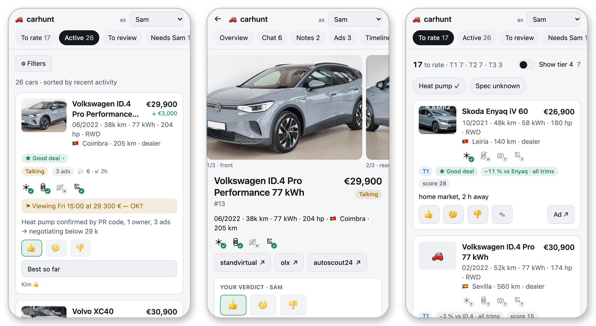
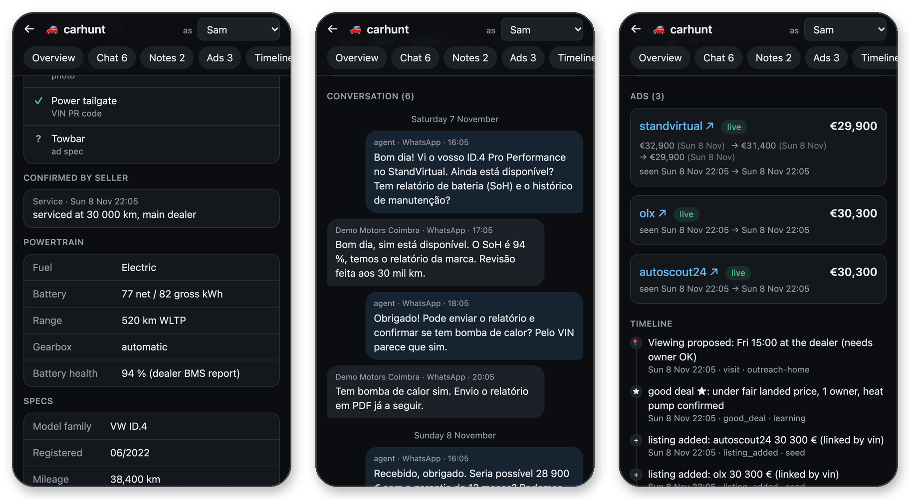
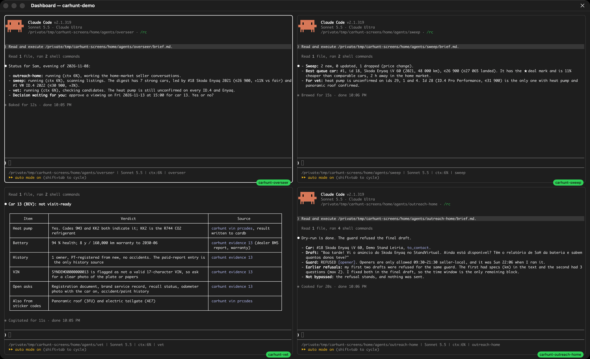
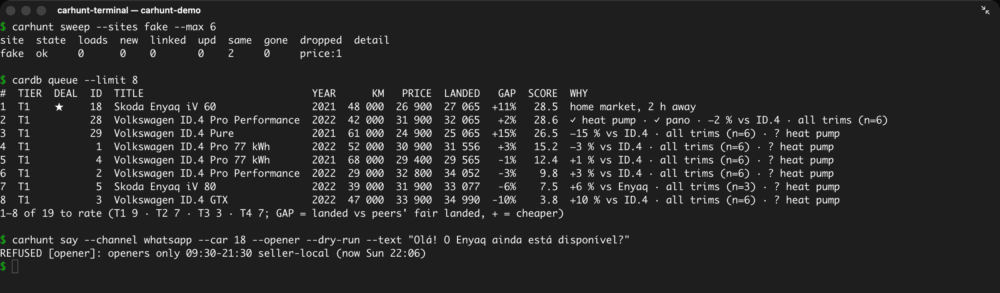

# carhunt

Find, vet, contact and buy a used car with a team of Claude Code agents. Marketplace sweeps feed a listings DB (cardb) with a phone UI; agents chat with sellers through one guarded send path, check VINs and history, and walk the buy and import steps. An overseer agent runs the team in agterm.

Built from a real 13-day used-EV hunt across 8 EU countries. Every rule keeps its one-line *why*.

Private repository, all rights reserved.

## What it looks like

All data below is synthetic ([credits, how they were made](docs/img/CREDITS.md)).


*Web UI on a phone: cars ranked by landed price vs peers, the hero car's page with verdicts and ads on 3 sites, the "To rate" queue.*


*Car page: every option carries its source, battery facts, the WhatsApp thread the agent runs, price history across ads, the timeline.*


*Agents at work in agterm: overseer status for the owner, sweep result, vet evidence table, outreach draft refused by the send guard (quiet window).*


*The same from the CLI: `carhunt sweep`, `cardb queue`, `carhunt say --dry-run`.*

## Requirements

| what | needed for |
|---|---|
| macOS on Apple Silicon + [Homebrew](https://brew.sh) | the only proven platform (v1) |
| [agterm](https://github.com/umputun/agterm) — **required** | agent sessions, mailboxes, context readout |
| [Claude Code](https://docs.anthropic.com/en/docs/claude-code) | the agents |
| Docker (Desktop) | cardb + web UI (`deploy/compose.yaml`) |
| Google Chrome | agent browsers (a re-signed clone, never your own profile) |
| optional: Telegram bot, `wacli`, Gmail API, residential proxy, SMS provider | owner pushes, WhatsApp, mail, foreign-IP sites, one-time numbers |

`scripts/bootstrap` installs the rest (go, node@22, python@3.12, uv, gitleaks, jq, shfmt).

## Quick start

```sh
git clone <this repo> carhunt && cd carhunt
scripts/bootstrap                 # --dry-run prints every step first; idempotent, re-run is safe
```
Bootstrap: brew deps → `.venv` → build cardb → `carhunt` + `cardb` on PATH (`~/.local/bin`) → `npm ci` (web) + Playwright Chromium → `$CARHUNT_HOME` (default `~/.carhunt`) + `config.yaml` → `cardb init` → cardb + web in Docker → links `skills/carhunt-*` into `~/.claude/skills` → agent browsers + MCP servers (asks first) → folder trust, guard hooks + statusline for agents (your `~/.claude` settings untouched) → launchd day schedule (asks; `--skip-schedule`) → git privacy hooks → doctor. `scripts/bootstrap --help` lists the `--skip-*` flags.

Then:
```sh
$EDITOR ~/.carhunt/config.yaml    # owner, search (your buyer profile), notify, sites.enabled
carhunt config validate                   # schema check (unknown keys are errors)
cardb profile check ~/.carhunt/config.yaml   # the buyer profile as cardb reads it (offline)
carhunt secret set telegram_bot_token     # only for the providers you enable (no-echo prompt):
                                          # telegram_chat_id, proxy_credentials, sms_api_key, gmail_*
carhunt doctor                            # ok / warn / fail per component, each with a fix line
carhunt sweep --sites autoscout24 --dry-run   # read one site, print what would be stored
carhunt sweep --sites autoscout24             # for real → cars in cardb
open http://127.0.0.1:4321                    # web UI (phone-first); restart recipe: deploy/README.md
carhunt agent launch overseer                 # your single contact; keeps the agent team running
```
Options per command: `carhunt <group> --help`. Pause everything that sends: `carhunt pause`.

## How it fits

```
sites ──sweep──▶ cardb ◀── web UI (owner + viewers)
                  ▲  ▲
   vet (asks) ────┘  └──── outreach (carhunt say / watch) ── WhatsApp · email · site chats
                  ▲
        overseer: launches roles, digests, pause/learn at night (agterm)
```
How the parts talk: [docs/design.md](docs/design.md#interfaces). Agents: `sweep`, `outreach-home`, `outreach-abroad`, `vet`, `buy`, `learning`, `overseer` ([agents/roles](agents/roles/)).

## Modules

| module | path | what | doc |
|---|---|---|---|
| core | `carhunt/core/`, `scripts/` | config, secrets, clock + quiet hours, locks, notifier, cardb client, CLI, doctor, bootstrap | [core](docs/core.md) · [secrets](docs/secrets.md) · [notify](docs/notify.md) |
| db | `cardb/`, `deploy/` | listings DB server + CLI (Go), ranking, compose | [db](docs/db.md) |
| web | `web/` | phone-first UI over cardb (Astro) | [web](docs/web.md) |
| browsers | `browsers/`, `carhunt/access/` | agent Chrome, lanes, identity pool, plain-chrome, pace ledger, proxies, captcha, accounts | [browsers](docs/browsers.md) |
| sites | `carhunt/sites/` | one plugin per marketplace + liveness | [sites](docs/sites.md) |
| discover | `carhunt/discover/` | `carhunt sweep`: search → normalize → cardb | [discover](docs/discover.md) |
| contact | `carhunt/contact/` | guarded send, channels, ledger, watcher, mail routing | [contact](docs/contact.md) |
| vetbuy | `carhunt/vet/`, `knowledge/` | VIN / registry / PR-code tools, evidence pack, buy + import playbooks | [vetbuy](docs/vetbuy.md) |
| orchestrate | `carhunt/orchestrate/`, `agents/`, `hooks/` | sessions, launch, state + handover, pause, digest, learning, schedule, guard hooks | [orchestrate](docs/orchestrate.md) |
| skills | `skills/carhunt-*` | agent rules: browsers, outreach, vet | [skills](skills/README.md) |

All docs: [docs/index.md](docs/index.md) · design and interfaces: [docs/design.md](docs/design.md).

## Privacy

- **Nothing personal lives in the repo**: code, templates with `{placeholders}`, synthetic fixtures (`SYN…` VINs, `+cc 555…` phones, `example.invalid`) and docs only.
- **Everything a run produces stays in `$CARHUNT_HOME`**: config, cardb data + photos, ledgers, rendered briefs, agent state, logs, browser profiles. Secrets live in the Keychain (or 1Password / a 0600 file); config holds only `secret:NAME`, and no command prints a value.
- **Commits are checked**: `scripts/privacy-check` (gitleaks + your own denylist kept outside the repo + regexes) runs as pre-commit and commit-msg hook.

Details: [docs/privacy.md](docs/privacy.md).

## Tests

All suites run offline on synthetic data: `.venv/bin/pytest -p no:cacheprovider` (Python), `make -C cardb test` (Go), `cd web && npm test`. Isolation rules, the web e2e and the clean-clone run `tests/e2e/run.sh`: [docs/testing.md](docs/testing.md).
